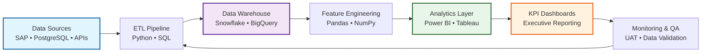
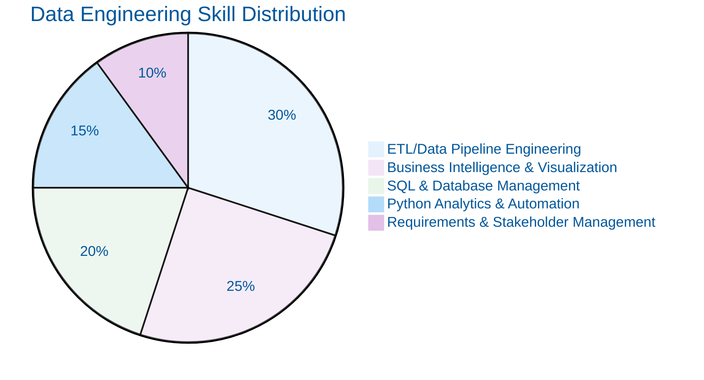
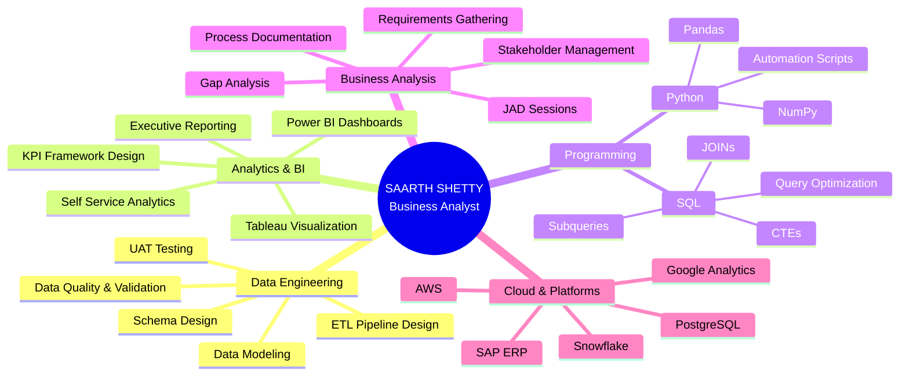
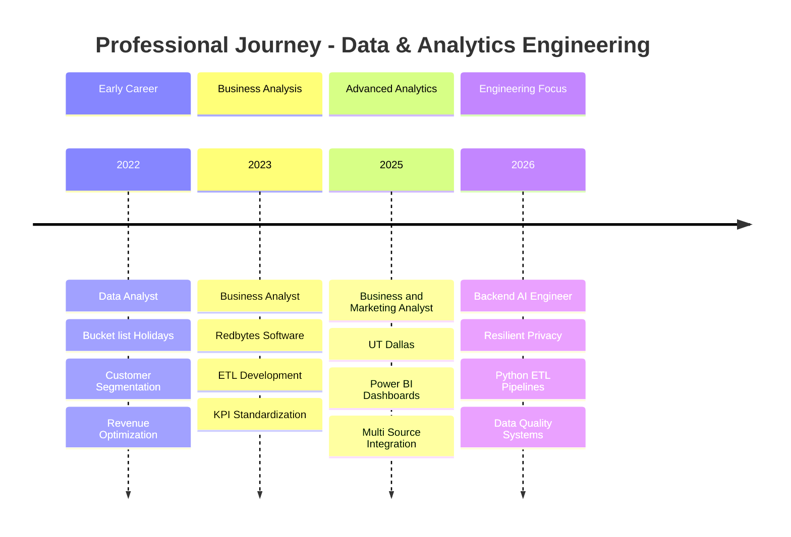

# 📊 SAARTH SHETTY

### Business Analyst | Data Engineering Specialist | Analytics Architect

*Translating Complex Data into Decision-Ready Intelligence*

---

## 🎓 RESEARCH ABSTRACT

Business Analyst with 3+ years of professional experience engineering data-driven decision frameworks across operational, financial, and analytical domains. Specialized in designing **end-to-end ETL pipelines**, **KPI frameworks**, and **multi-source analytical dashboards** that connect performance metrics to strategic operational decisions. Technical proficiency spans **Python (NumPy, Pandas)**, **SQL (CTEs, JOINs, Subqueries)**, **Power BI**, and **cloud data platforms (AWS, Snowflake)**. Academic foundation in **IT and Management (M.S., UT Dallas)** and **Computer Science with Honors in Data Science (B.E., Mumbai University)**.

**Research Interests:** Data Engineering Architecture • Business Intelligence Systems • Automated Analytics Workflows • Operational Data Integrity • Statistical Analysis for Decision Support

---

## 🔬 ML/DATA ENGINEERING PIPELINE

---

## 📈 PROJECT PERFORMANCE METRICS

### Featured Data Engineering Projects

| Project | Domain | Key Metric | Impact | Technologies |
|---------|--------|------------|--------|--------------|
| **Healthcare Claims Data Warehouse** | Healthcare Analytics | 40% reduction in validation effort | Zero critical defects at UAT | ETL, SQL, BI, Agile |
| **Multi-Source KPI Dashboard** | Operations Intelligence | 25% faster reporting turnaround | Real-time tracking across 5+ workflows | Power BI, Tableau, JAD |
| **Python ETL Automation Framework** | Data Engineering | 40% reduction in manual processing | Improved data integrity across 5+ environments | Python, ETL, UAT |
| **Customer Segmentation Analysis** | E-Commerce Analytics | 20% reduction in cancellations | Revenue increase via targeted upsells | Python, Pandas, NumPy |
| **Operational Data Quality System** | Data Governance | 35% improvement in pipeline reliability | Reduced escalations & data inconsistencies | Python, SQL, Data Validation |

### System Performance Summary

---

## 💻 TECHNICAL STACK

### Core Languages & Frameworks

### Data Engineering & ETL

### Business Intelligence & Visualization

### Analytics & Automation Tools

---

## 🗺️ EXPERTISE ARCHITECTURE

---

## 📊 CAREER TRAJECTORY

---

## 🏆 PROFESSIONAL EXPERIENCE & ACHIEVEMENTS

### Backend AI Engineer | Resilient Privacy
*Jan 2026 - May 2026*

**Impact Metrics:**
- ⚡ **40% reduction** in manual data processing effort across 5+ production environments
- 📊 **35% improvement** in pipeline output reliability through reusable Python frameworks
- ✅ **Zero data inconsistencies** post-UAT validation, ensuring reporting compliance

**Technical Contributions:**
- Engineered Python ETL pipelines with automated data cleansing logic
- Designed end-to-end User Acceptance Testing frameworks validating schemas against business requirements
- Built reusable Python frameworks for cross-system data quality reconciliation

**Technologies:** `Python` `ETL` `UAT` `Data Quality` `Schema Validation`

---

### Business and Marketing Analyst | University of Texas at Dallas
*Jan 2025 - Jan 2026*

**Impact Metrics:**
- 📈 **25% reduction** in reporting turnaround time
- 🎯 **30% improvement** in analytics infrastructure efficiency
- 📊 Real-time KPI tracking across **5+ reporting workflows**

**Technical Contributions:**
- Built self-service Power BI and Tableau dashboards integrating multi-source datasets
- Led stakeholder JAD sessions to align cross-functional teams on KPI definitions
- Audited data sources for gaps, documented lineage and reporting logic for traceable dashboards

**Technologies:** `Power BI` `Tableau` `JAD` `KPI Framework` `Data Lineage` `Multi-Source Integration`

---

### Business Analyst | Redbytes Software Pvt Ltd
*Jan 2023 - May 2024*

**Impact Metrics:**
- 🔧 **20% reduction** in data pipeline errors
- 📊 Standardized operational KPI tracking across **3+ business units**
- ⏱️ Reduced documentation cycle time through structured requirements gathering

**Technical Contributions:**
- Analyzed ERDs and database models to develop Teradata SQL-based ETL mappings
- Designed Power BI dashboards with defined metric logic and data quality controls
- Partnered with technical and business stakeholders to translate operational needs into data products

**Technologies:** `Teradata SQL` `ETL` `Power BI` `ERD Analysis` `Database Modeling`

---

### Data Analyst | Bucket list Holidays
*Jan 2022 - Dec 2022*

**Impact Metrics:**
- 💰 Increased **revenue per booking** through high-value customer segmentation
- 📉 **20% reduction** in trip cancellation rate across regional markets
- 👥 Analyzed **5,000+ customers** for demographic and purchase patterns

**Technical Contributions:**
- Segmented customers into high-value cohorts via Python demographic and purchase history analysis
- Mapped booking drop-offs and presented conversion diagnostics to leadership
- Enabled targeted intervention strategies for high-risk customer segments

**Technologies:** `Python` `Pandas` `Customer Segmentation` `Cohort Analysis` `Data Visualization`

---

## 🎯 FEATURED DATA PROJECTS

### 🏥 Healthcare Claims Data Warehouse & ETL Mapping

**Project Type:** Enterprise Data Warehouse | ETL Architecture | Requirements Engineering

**Problem Statement:**
Consolidate Medicare claims data from multiple source systems and file specifications into a unified data warehouse with robust ETL mappings and BI report specifications.

**Solution Architecture:**
- Designed star schema data warehouse consolidating disparate source systems
- Built ETL mappings with 130+ source-to-target field validations
- Authored comprehensive test plans and traceability matrices
- Led structured requirements workshops analyzing ERDs and database models

**Quantified Outcomes:**
- ✅ **40% reduction** in requirements validation effort across 4-sprint Agile cycle
- ✅ **Zero critical defects** at UAT sign-off
- ✅ SQL-based test data creation and verification queries ensuring data accuracy
- ✅ Phased ETL work breakdown structure for scalable implementation

**Technical Stack:** `ETL` `SQL` `BI Reporting` `Agile` `UAT` `ERD Analysis` `Data Warehouse Design`

**Key Deliverables:**
- Star schema dimensional model
- 130+ field-level ETL mappings
- Comprehensive test plans with traceability matrices
- SQL verification queries for data validation
- Phased implementation roadmap

---

### 🔄 Data Pipeline with dbt using Airflow on GCP

**Project Type:** Modern Data Stack | Orchestration | Data Quality

**Repository:** [View on GitHub](https://github.com/SAARTH4555/data-pipeline-with-dbt-using-airflow-on-gcp)

**Architecture Overview:**
End-to-end data pipeline demonstrating modern data engineering practices using Astronomer (Airflow wrapper), dbt for data modeling, Soda for data quality checks, and Metabase for visualization—all orchestrated on Google Cloud Platform.

**Technical Implementation:**
- **Data Ingestion:** Automated pipeline extracting data into GCP BigQuery
- **Data Quality:** Highly customized checks using Soda YAML configurations
- **Data Transformation:** Star schema modeling with dbt SQL transformations
- **Data Loading:** Automated loading into GCP BigQuery tables
- **Data Reporting:** Containerized Metabase dashboards for analytics

**Technology Stack:**
- **Orchestration:** Astro CLI (Airflow wrapper), Apache Airflow DAGs
- **Transformation:** dbt (Data Build Tool) for SQL-based modeling
- **Quality:** Soda for automated data validation
- **Storage:** Google BigQuery, GCP Cloud Storage
- **Visualization:** Metabase (containerized)
- **Infrastructure:** Docker, VirtualBox

**Key Features:**
- Scalable DAG-based workflow automation
- Version-controlled data transformations
- Automated data quality validation
- Real-time dashboard generation
- Cloud-native architecture

**Dataset:** Online Retail II (UK-based e-commerce transactions, 01/12/2009 - 09/12/2011)

---

### 💰 Retail Insights: Analytics Engineering with dbt

**Project Type:** Analytics Engineering | Dimensional Modeling | Business Metrics

**Repository:** [View on GitHub](https://github.com/SAARTH4555/retail_insights)

**Project Philosophy:**
*"Most analytics portfolios stop at a chart. This one shows the engineering behind the numbers."*

**Comprehensive Data Pipeline:**
Raw Data → Tested dbt Star Schema → Advanced SQL Metrics → Executive Dashboard

**Quantified Results (541,909 UK E-Commerce Transactions):**
- 💷 **GBP 8.91M** total revenue over 13-month period
- 📈 **+47.6% MoM growth** peak (September 2011)
- 👥 **~20.6%** average month-1 customer retention
- 🏆 **974 "Champions"** (22.5% of customers) driving ~GBP 5M+ revenue

**Technical Excellence:**
- ✅ **79 passing dbt tests** ensuring data quality
- 📊 **Star schema dimensional model** with fact and dimension tables
- 🔍 **Advanced SQL techniques:** Cohort analysis, RFM segmentation, window functions
- 📈 **Cross-mart reconciliation** for data integrity
- 📝 **Complete lineage documentation**

**Business Questions Answered:**

| # | Business Question | SQL Technique | Key Finding |
|---|---|---|---|
| 1 | Revenue trend & momentum | LAG, cumulative SUM | GBP 8.91M; +47.6% best MoM jump |
| 2 | Customer retention patterns | Cohort logic | 20.6% avg retention; 36.6% Dec-2010 cohort |
| 3 | Customer value segmentation | NTILE(5), RFM | 974 Champions (22.5%) drive majority revenue |
| 4